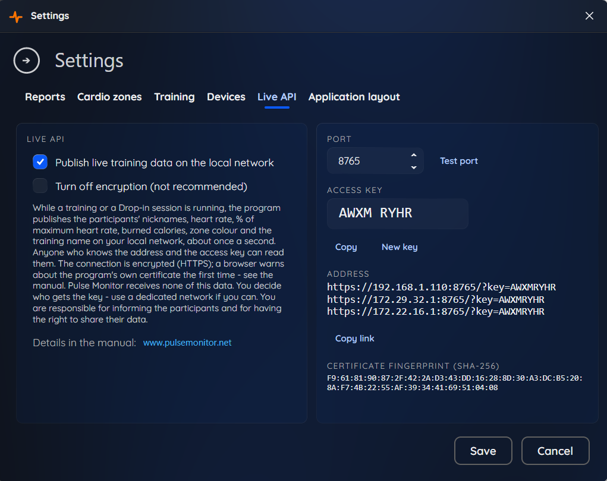
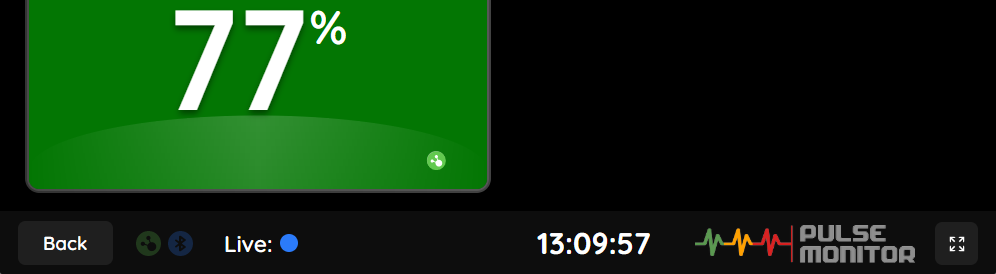
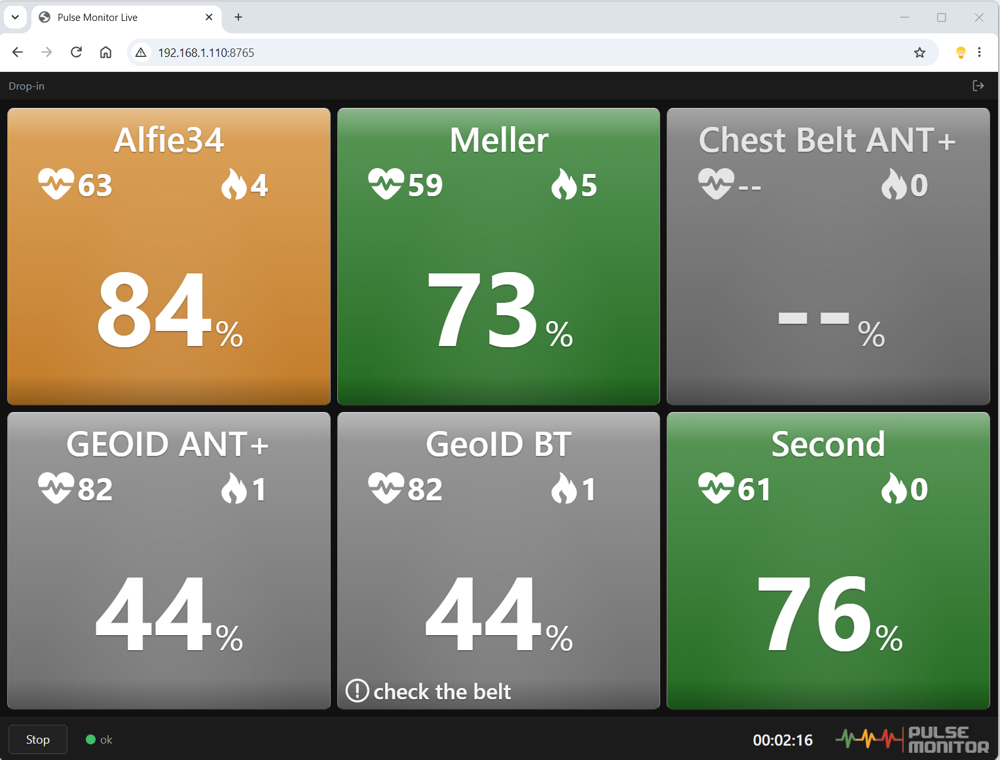

# Pulse Monitor Live API

## About Pulse Monitor

Pulse Monitor is a Windows application that shows the heart rate of everyone in a group class live, on one screen, and records it so that each participant can get a report afterwards. It is built for fitness clubs, indoor-cycling studios, gyms, schools and any place where a trainer wants to see at a glance who is working too hard, who is not working hard enough, and who needs a break.

- Download the program and get a license: [www.pulsemonitor.net](https://www.pulsemonitor.net/)
- User manual: [www.pulsemonitor.net/manual](https://www.pulsemonitor.net/manual)

## Pulse Monitor Live API

Pulse Monitor can present training data in near real time through an API. The Live API was introduced in
**Pulse Monitor 5**. While a training (or a Drop-in session) is
on screen, the application **starts its own small server** on the computer it runs on and publishes the current state of all
participants about once per second **on your local network**. Your own display, dashboard or integration connects to that
computer and reads the data. The server stops when the training screen is closed.
Use it to build your own screens, dashboards or recording tools.

The data stays on your network: it goes from the Pulse Monitor computer straight to the readers you choose,
**encrypted** (HTTPS and WSS). You decide who gets access, and you can switch the feature off at any time.

- [Enabling the API](#enabling-the-api) - address, port and access key
- [Encryption and the certificate](#encryption-and-the-certificate) - what the browser warns about, and how a program checks it
- [Built-in viewer](#built-in-viewer) - open the address in a browser or on a TV
- [Connecting](#connecting) - `GET /live` and the WebSocket `/ws`
- [Is the training running?](#is-the-training-running) - how to interpret what you get
- [Data format](docs/data-format.md) - fields of the data snapshot
- [examples/](examples/) - ready-to-run clients
- [webclient/](webclient/) - a browser live view in plain JavaScript

## Enabling the API

The Live API is an optional feature of Pulse Monitor, available from **version 5** and with licenses that include it.

1. In Pulse Monitor open **Settings** and the **Live API** tab (it is shown only when your license includes the feature).
2. Tick **Publish live training data on the local network** and save.
3. The tab shows the **address** of the computer (for example `https://192.168.1.15:8765`), the **port** (you can change it)
   and the **access key**: 8 characters, for example `K7MH 3RAW`. Case, spaces and dashes do not matter. It also shows the
   **fingerprint** of the certificate (see [below](#encryption-and-the-certificate)).
   **Test port** checks that the port is free and makes Windows Firewall ask for permission the first time:
   allow access on private networks.



The server runs only while a training or a Drop-in screen is open. While it runs, the bottom bar of the training screen shows
the **Live** indicator:



Things to know:

- **The connection is encrypted** (HTTPS and WSS). Anyone who knows the key can read the data, so give the key only to
  people and devices that should have it, and use a dedicated network if you can. **New key** in the same tab replaces
  the key at once; readers using the old one stop receiving data.
- Every device that should read the data must be able to reach the computer on that port, so the Windows Firewall of that
  computer must allow it.
- Browsers: a page served over `https://` cannot read from a plain-`http://` server (mixed content). This only matters if
  the encryption was turned off (see below).

## Built-in viewer

You do not have to build anything to see the data: open the address in a browser on any device on the same network,
with the key in the link, for example

```
https://192.168.1.15:8765/?key=K7MH3RAW
```

The first time, the browser warns that the certificate is not trusted (it is made by Pulse Monitor itself; see
[below](#encryption-and-the-certificate)). The Live API tab in Pulse Monitor shows this link and copies it for you. The page shows the participants as tiles, like the
training screen of the program, and is the same as the [web client](webclient/) in this repository. The page and its files carry
no data and need no key; the data does.



## Encryption and the certificate

Everything the server sends - the page, `/live` and the `/ws` stream - is encrypted with TLS (**HTTPS** and **WSS**), on one
port. The certificate is **made by Pulse Monitor on the computer** the first time it is needed, and is **self-signed**: nobody
can issue a certificate for the private address of a computer, so no browser knows it in advance.

- **A browser** warns the first time ("Your connection is not private" or similar). Open the link, choose to continue
  (in Chrome and Edge: *Advanced* → *Continue to ...*), and the browser remembers the choice for that address.
  A page that Pulse Monitor serves needs this only once; then its data connection works too.
- **A program** should not simply switch the check off. The **Live API** tab shows the certificate's
  **SHA-256 fingerprint**; compare it with the fingerprint of the certificate the server presents, and trust only that
  one (certificate pinning). The certificate stays the same until the computer's network addresses change or it nears
  its end (about two years), so a reader that pinned it must be updated then.
- If the computer gets a new address (for example from DHCP), the program makes a new certificate that includes it, and the
  fingerprint changes.

**Turning the encryption off.** The Live API tab has one option, **Turn off encryption (not recommended)**. After you confirm
(*Are you sure?*) the server speaks plain HTTP and WS instead, on the same port, and the links become `http://` and
`ws://`. Anyone who can see the traffic of the network can then read the data. Use it only on a network that only you
control, or when a device cannot accept the certificate. It is one switch for the whole connection - the page and the data are
never encrypted separately.

## Connecting

The key goes in the query string, `?key=K7MH3RAW`, or in the header `Authorization: Bearer K7MH3RAW`.
In a browser use the query string: it needs no special permission (CORS preflight).

### `GET /live`

Returns the most recent snapshot.

```bash
curl -k "https://192.168.1.15:8765/live?key=K7MH3RAW"
```

`-k` makes curl accept the self-signed certificate; see [Encryption and the certificate](#encryption-and-the-certificate)
for a better way.

| Status | Body | Meaning | What to do |
|---|---|---|---|
| `200` | the latest snapshot (see [Data format](docs/data-format.md)) | Data found | Show it; check its age ([below](#is-the-training-running)) |
| `503` | `{"status":"no data yet"}` | The server runs, but there is no snapshot yet | Show "waiting for the training" and keep polling |
| `401` | `{"status":"unauthorized"}` | The key is missing or wrong | Fix the key; retrying will not help |
| `429` | `{"status":"too many attempts"}` | Too many wrong keys from your address; it is locked out | Wait at least the number of seconds in the `Retry-After` header |

All responses are `application/json`, are never cached (`Cache-Control: no-store`) and allow any origin
(`Access-Control-Allow-Origin: *`).

### `GET /ws` (WebSocket)

Pushes every new snapshot as it is published, about once per second. You receive the latest snapshot immediately after connecting.
Messages are text frames with the same JSON as `/live`.

```js
const ws = new WebSocket("wss://192.168.1.15:8765/ws?key=K7MH3RAW");
ws.onmessage = (event) => console.log(JSON.parse(event.data));
```

A WebSocket that is refused (wrong key, locked out, or more than 20 clients connected) simply fails to open and a browser does
not tell you why. If you need the reason, ask `GET /live` first, as the [web client](webclient/) does.

### Wrong keys

Five wrong keys from one address lock that address out for 60 seconds (`429`), whatever key it sends in that time.
A person who mistyped the key once or twice is not affected.

## Is the training running?

There is no "training started" or "training ended" message. You derive the state from what you receive:

| What you get | State | Show |
|---|---|---|
| `503` from `/live` | The server runs but nothing has been published yet | "Waiting for the training" |
| a snapshot whose `sentAt` is recent | Live | The participants, updated every second |
| no new snapshots, or a `sentAt` older than a few seconds | Not transmitting: the training screen was closed, or the program lost the sensors | The last values, marked as stale / "training ended" |
| connection refused / timeout | The server is not running: no training or Drop-in screen is open, the Live API is switched off, or the computer is not reachable | "Cannot connect", retry later |

`sentAt` is the only liveness signal: it is the UTC time (`yyyy-MM-ddTHH:mm:ssZ`) at which the snapshot was taken, and it changes
with every new snapshot.

```js
// "Live" when the snapshot is at most 5 seconds old. Use a synchronised clock (NTP);
// if your clock may be off by seconds, use a larger threshold (10 s) or remember when `sentAt` last changed.
function isLive(snapshot, staleMs = 5000) {
  return Date.now() - Date.parse(snapshot.sentAt) <= staleMs;
}
```

Notes:

- Snapshots arrive about once per second but a few may be skipped; gaps in `seq` are normal. Do not treat one missed second as the end.
- During a pause the participants keep updating and `sentAt` keeps changing; only `training.elapsedSec` stands still.
- When the server starts again (a new training screen), `seq` starts again from 1.

### Things to know

- **Polling:** once per second is plenty, because the data changes about once per second. Right after a training screen
  is opened the first snapshot can take a moment.
- **Back-off:** on a network error retry after a few seconds (5 s, then 15 s, then 60 s is a good back-off).
- **Always the latest state:** every snapshot contains the complete state of all participants, so you only ever need the last one.
  A slow reader is never waited for; it simply receives the newest snapshot when it is ready.
- **Limits:** at most 20 WebSocket clients at a time.
- **Keep the key secret:** it gives access to the live data of one Pulse Monitor computer.
- **Health data:** heart rate together with a nickname is health data. Do not write snapshots to logs and handle them
  according to the privacy rules that apply to you. Inform the participants.

## Examples

Ready-to-run clients in [examples/](examples/):

| File | Runtime | How it reads |
|---|---|---|
| [read.sh](examples/read.sh) | `curl` | polls `/live` |
| [read.mjs](examples/read.mjs) | Node.js 18+ | polls `/live` |
| [read.php](examples/read.php) | PHP 8+ | polls `/live` |
| [read.py](examples/read.py) | Python 3 (`requests`) | polls `/live` |
| [ws.mjs](examples/ws.mjs) | Node.js 22+ | WebSocket `/ws` |

Set the address and the key in the `PULSE_HOST` (for example `192.168.1.15:8765`; `https://` is assumed, write
`http://192.168.1.15:8765` when the encryption was turned off) and `PULSE_KEY` environment variables.
The examples accept the self-signed certificate without checking it; a real reader should check the fingerprint
([below](#encryption-and-the-certificate)).

## Disclaimer

This documentation and the example code are not part of the Pulse Monitor application. They are provided as a convenience
for developers who want to read the data published by the application, and you use them at your own discretion and risk.

## License

The documentation and examples in this repository are released under the [MIT License](LICENSE): free to use, copy and modify,
provided "as is", without warranty of any kind. The license covers only the contents of this repository; it does not cover
the Pulse Monitor application, which is subject to its own terms.

---

&copy; 2026 Radeal sp. z o.o. All rights reserved for the Pulse Monitor name and application.
